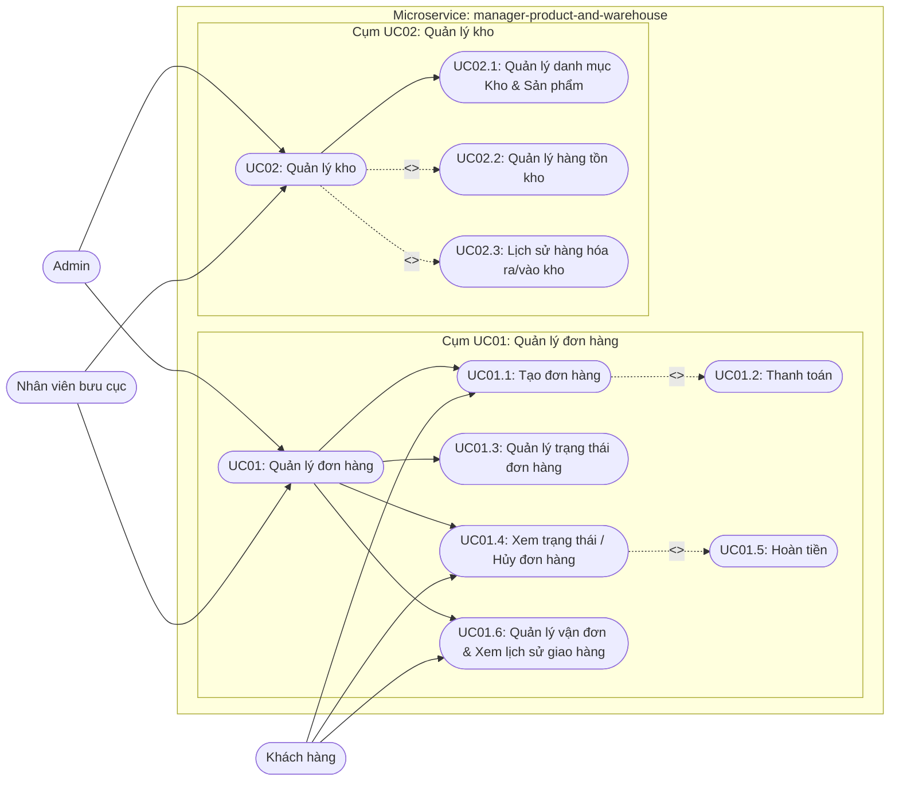

# TÀI LIỆU ĐẶC TẢ YÊU CẦU PHẦN MỀM (SRS)
## Microservice: Quản Lý Đơn Hàng & Quản Lý Kho (`manager-product-and-warehouse`)

---

## 1. Giới Thiệu Chung

### 1.1. Mục đích tài liệu
Tài liệu này đặc tả chi tiết các yêu cầu chức năng (Functional Requirements) và phi chức năng (Non-Functional Requirements) cho phân hệ **Quản lý Đơn hàng & Quản lý Kho** thuộc dự án **Hệ thống Quản lý Vận đơn (DC-Post)**.

### 1.2. Phạm vi phân hệ (Microservice Boundary)
Dự án được phát triển bởi nhóm 3 thành viên theo kiến trúc Microservice. Phân hệ `manager-product-and-warehouse` chịu trách nhiệm xử lý toàn bộ nghiệp vụ của **2 đại Use Case**:
1. **UC01 - Quản lý Đơn hàng (Order Management):**
   - Tạo đơn hàng (dành cho Khách hàng và Nhân viên bưu cục).
   - Thanh toán đơn hàng (`<<include>>`).
   - Quản lý & cập nhật trạng thái đơn hàng, lưu lịch sử chuyển đổi trạng thái.
   - Xem trạng thái đơn hàng, Hủy đơn hàng & Hoàn tiền (`<<extend>>`).
   - Điều phối vận đơn (`shipments`) và Xem lịch sử giao hàng (`shipment_tracking_events`).
2. **UC02 - Quản lý Kho (Warehouse & Inventory Management):**
   - Quản lý thông tin Kho/Bưu cục (`warehouses`) và Nhân viên kho (`warehouse_staff`).
   - Quản lý danh mục Sản phẩm/Hàng hóa (`products`).
   - Quản lý hàng tồn kho (`inventory`: tồn thực tế & tồn giữ chỗ) (`<<extend>>`).
   - Lịch sử hàng hóa ra/vào kho (`inventory_transactions`) (`<<extend>>`).

---

## 2. Danh Mục Tác Nhân (Actors)

| STT | Tác nhân | Mã Role | Mô tả quyền hạn trong phân hệ |
| :-: | :--- | :---: | :--- |
| 1 | **Khách hàng** | `CUSTOMER` | Tạo đơn hàng, thanh toán, xem trạng thái đơn hàng của mình, yêu cầu hủy đơn hàng (và nhận hoàn tiền nếu đã thanh toán), xem lịch sử giao hàng. |
| 2 | **Nhân viên bưu cục / Nhân viên kho** | `STAFF` | Kế thừa quyền Nhân viên: Tạo đơn hàng tại quầy cho khách, cập nhật trạng thái đơn hàng, tạo vận đơn, quét mã luân chuyển kho, quản lý hàng tồn kho (nhập/xuất/kiểm kê), xem lịch sử hàng hóa ra/vào kho. |
| 3 | **Quản trị viên** | `ADMIN` | Kế thừa quyền Nhân viên: Toàn quyền quản lý danh mục kho, phân công nhân viên kho, quản lý danh mục sản phẩm, duyệt hoàn tiền và giám sát toàn bộ đơn hàng/kho bãi. |

---

## 3. Sơ Đồ Use Case Tổng Quan (Sau Khi Gộp Chuẩn Hóa)

---

## 4. Đặc Tả Chi Tiết Use Case

### 4.1. Đặc tả UC01: Quản Lý Đơn Hàng

| Thuộc tính | Nội dung chi tiết |
| :--- | :--- |
| **Mã Use Case** | **UC01** |
| **Tên Use Case** | Quản lý đơn hàng (Gộp: Tạo đơn, Thanh toán, Quản lý trạng thái, Hủy đơn & Hoàn tiền, Lịch sử giao hàng) |
| **Tác nhân chính** | Khách hàng (`CUSTOMER`), Nhân viên bưu cục (`STAFF`), Admin (`ADMIN`) |
| **Tiền điều kiện (Pre-conditions)** | 1. Người dùng đã đăng nhập và có JWT Token hợp lệ từ Auth Service. 2. Danh mục sản phẩm (`products`), kho (`warehouses`), và bảng trạng thái (`order_statuses`) đã được khởi tạo. |
| **Hậu điều kiện (Post-conditions)** | 1. Dữ liệu đơn hàng (`orders`, `order_items`), thanh toán (`payments`), lịch sử trạng thái (`order_status_history`), vận đơn (`shipments`) được lưu trữ toàn vẹn (ACID) trong PostgreSQL. 2. Số lượng tồn kho giữ chỗ (`reserved_quantity`) hoặc tồn thực tế (`quantity`) được cập nhật chính xác. |

#### Luồng sự kiện chính (Main Success Scenarios):

##### Luồng A: Tạo đơn hàng & Thanh toán (`UC01.1` & `UC01.2`)
1. Khách hàng (hoặc Nhân viên bưu cục tạo hộ khách) gửi yêu cầu tạo đơn hàng gồm: thông tin khách hàng (`custom_id`), kho xuất hàng (`warehouse_id`), danh sách mặt hàng (`product_id`, `quantity`), và phương thức thanh toán (`payment_method`: `COD`, `BANK_TRANSFER`, `E_WALLET`).
2. Hệ thống bắt đầu một Database Transaction (`BEGIN`).
3. Hệ thống truy vấn bảng `products` để lấy đơn giá (`unit_price`) và tên sản phẩm (`product_name`).
4. Hệ thống khóa dòng tồn kho (`SELECT ... FOR UPDATE`) trong bảng `inventory` theo `warehouse_id` và `product_id` để kiểm tra:
   $$\text{Available Stock} = \text{quantity} - \text{reserved\_quantity} \ge \text{order\_quantity}$$
5. Hệ thống cộng thêm số lượng đặt vào cột `reserved_quantity` trong bảng `inventory` và ghi log vào `inventory_transactions` (loại `RESERVE`).
6. Hệ thống sinh mã đơn hàng duy nhất (`order_code`, ví dụ: `ORD-20261124-XXXX`), tính tổng tiền (`total_amount`) và lưu vào bảng `orders` với trạng thái ban đầu là `PENDING`, cùng danh sách chi tiết vào bảng `order_items`.
7. Hệ thống ghi nhận lịch sử trạng thái đầu tiên vào bảng `order_status_history` (`old_status_id = NULL`, `new_status_id = PENDING`, `changed_by = user_id`).
8. **Include Thanh toán:** Hệ thống khởi tạo bản ghi trong bảng `payments` với `amount = total_amount`, `payment_method`, và `payment_status = PENDING` (hoặc `PAID` nếu thanh toán trực tiếp tại quầy).
9. Hệ thống `COMMIT` transaction và trả về thông tin đơn hàng vừa tạo.

##### Luồng B: Quản lý trạng thái đơn hàng & Điều phối vận đơn (`UC01.3` & `UC01.6`)
1. Nhân viên bưu cục chọn đơn hàng và thực hiện chuyển trạng thái theo quy trình: `PENDING` -> `CONFIRMED` -> `PROCESSING` -> `SHIPPING` -> `DELIVERED`.
2. Hệ thống kiểm tra tính hợp lệ của việc chuyển trạng thái (State Machine).
3. Hệ thống cập nhật `status_id` trong bảng `orders` và thêm bản ghi mới vào `order_status_history`.
4. Khi đơn hàng chuyển sang giai đoạn giao hàng (`SHIPPING` / Tạo vận đơn):
   - Hệ thống tạo bản ghi `shipments` với mã `tracking_code` duy nhất, gắn `shipper_id`, `current_warehouse_id`, `cod_amount` và chi tiết `shipment_items`.
   - Hệ thống khấu trừ tồn kho thực tế tại kho xuất: giảm đồng thời `quantity` và `reserved_quantity` trong bảng `inventory`.
   - Hệ thống ghi bản ghi xuất kho vào `inventory_transactions` (`transaction_type = EXPORT`, gắn `shipment_id`).
   - Hệ thống ghi sự kiện đầu tiên vào `shipment_tracking_events`.
5. Trong quá trình vận chuyển qua các bưu cục, nhân viên quét mã vận đơn để thêm sự kiện vào `shipment_tracking_events` (`from_warehouse_id` -> `warehouse_id`, `scanned_by`, `scanned_at`), giúp Khách hàng xem được **Lịch sử giao hàng** theo thời gian thực.

##### Luồng C: Xem trạng thái / Hủy đơn hàng & Hoàn tiền (`UC01.4` & `UC01.5`)
1. Khách hàng xem chi tiết đơn hàng, lịch sử trạng thái (`order_status_history`) và hành trình vận đơn (`shipment_tracking_events`).
2. Khách hàng (hoặc Nhân viên) gửi yêu cầu **Hủy đơn hàng**.
3. Hệ thống kiểm tra trạng thái hiện tại của đơn hàng: chỉ cho phép hủy khi đơn đang ở trạng thái `PENDING` hoặc `CONFIRMED` (chưa bàn giao vận chuyển `SHIPPING`).
4. Hệ thống cập nhật trạng thái đơn hàng sang `CANCELLED` và ghi vào `order_status_history`.
5. Hệ thống hoàn trả lại số lượng giữ chỗ: giảm `reserved_quantity` trong bảng `inventory` và ghi `inventory_transactions` (`transaction_type = RELEASE`).
6. **Extend Hoàn tiền:** Hệ thống kiểm tra bản ghi `payments` của đơn hàng:
   - Nếu `payment_status == 'PAID'`, hệ thống tự động tạo bản ghi trong bảng `refunds` (`refund_amount = payments.amount`, `refund_status = 'PENDING'`) để bộ phận kế toán/nhân viên xử lý hoàn tiền.

#### Luồng ngoại lệ (Exception Flows):
* **E1 - Không đủ hàng tồn kho:** Tại bước A.4, nếu `quantity - reserved_quantity < order_quantity`, hệ thống `ROLLBACK` và trả về lỗi `400 Bad Request (ERR_INSUFFICIENT_STOCK)` kèm thông tin sản phẩm thiếu.
* **E2 - Chuyển trạng thái không hợp lệ:** Nếu nhân viên chuyển từ `DELIVERED` về `PENDING`, hoặc khách hủy đơn đã `SHIPPING`, hệ thống từ chối và trả về lỗi `422 Unprocessable Entity (ERR_INVALID_STATUS_TRANSITION)`.

---

### 4.2. Đặc tả UC02: Quản Lý Kho

| Thuộc tính | Nội dung chi tiết |
| :--- | :--- |
| **Mã Use Case** | **UC02** |
| **Tên Use Case** | Quản lý kho (Gộp: Quản lý Kho & Sản phẩm, Quản lý hàng tồn kho, Lịch sử hàng hóa ra/vào kho) |
| **Tác nhân chính** | Nhân viên bưu cục (`STAFF`), Admin (`ADMIN`) |
| **Tiền điều kiện (Pre-conditions)** | Người dùng đăng nhập với vai trò `STAFF` hoặc `ADMIN`. |
| **Hậu điều kiện (Post-conditions)** | Mọi thay đổi về số lượng tồn kho trong `inventory` đều có bản ghi đối ứng trong `inventory_transactions`. |

#### Luồng sự kiện chính (Main Success Scenarios):

##### Luồng A: Quản lý danh mục Kho, Nhân viên kho & Sản phẩm (`UC02.1`)
1. Admin tạo/cập nhật thông tin Kho/Bưu cục (`warehouses`: `warehouse_name`, `address`).
2. Admin gán nhân viên phụ trách vào kho thông qua bảng `warehouse_staff` (`warehouse_id`, `user_id`).
3. Admin/Nhân viên tạo hoặc cập nhật danh mục Sản phẩm (`products`: `product_code` duy nhất, `product_name`, `unit_price`).

##### Luồng B: Quản lý hàng tồn kho - Nhập kho / Xuất kho / Kiểm kê (`UC02.2`)
1. Nhân viên kho chọn Kho (`warehouse_id`) để xem danh sách tồn kho hiện tại. Hệ thống trả về danh sách các mặt hàng kèm:
   - `quantity` (Tồn vật lý)
   - `reserved_quantity` (Tồn đang giữ cho đơn hàng chờ xuất)
   - `available_quantity` (`quantity - reserved_quantity`)
2. **Nghiệp vụ Nhập kho (`IMPORT`):**
   - Nhân viên nhập danh sách sản phẩm và số lượng nhập.
   - Hệ thống cộng số lượng vào `inventory.quantity` (nếu sản phẩm chưa có trong kho thì tự động khởi tạo dòng `inventory` mới).
   - Hệ thống ghi bản ghi vào `inventory_transactions` với `transaction_type = 'IMPORT'`, `performed_by = user_id`.
3. **Nghiệp vụ Xuất kho thủ công / Luân chuyển (`EXPORT`):**
   - Nhân viên chọn kho, sản phẩm, số lượng xuất (và `shipment_id` nếu xuất theo vận đơn).
   - Hệ thống kiểm tra tồn khả dụng, trừ `inventory.quantity` và ghi `inventory_transactions` với `transaction_type = 'EXPORT'`.
4. **Nghiệp vụ Kiểm kê / Điều chỉnh (`ADJUST`):**
   - Nhân viên cập nhật số lượng kiểm kê thực tế. Hệ thống tính độ lệch $\Delta = \text{new\_qty} - \text{old\_qty}$, cập nhật `inventory.quantity` và ghi `inventory_transactions` với `transaction_type = 'ADJUST'`.

##### Luồng C: Tra cứu Lịch sử hàng hóa ra/vào kho (`UC02.3`)
1. Nhân viên hoặc Admin truy cập chức năng lịch sử biến động kho.
2. Người dùng chọn bộ lọc: Mã kho (`warehouse_id`), Mã sản phẩm (`product_id`), Mã vận đơn (`shipment_id`), Loại giao dịch (`IMPORT`, `EXPORT`, `RESERVE`, `RELEASE`, `RETURN`, `ADJUST`), Khoảng thời gian (`from_date`, `to_date`).
3. Hệ thống truy vấn bảng `inventory_transactions` kết hợp thông tin `products` và `warehouses`, trả về danh sách phân trang sắp xếp theo thời gian mới nhất (`created_at DESC`).

---

## 5. Yêu Cầu Phi Chức Năng (Non-Functional Requirements)

1. **Tính toàn vẹn dữ liệu & Chống Race Condition (Concurrency Control):**
   - Khi nhiều đơn hàng cùng đặt 1 sản phẩm tại cùng 1 thời điểm, bắt buộc sử dụng cơ chế khóa bi quan (`SELECT ... FOR UPDATE` trong PostgreSQL Transaction) trên bảng `inventory` để không bao giờ xảy ra tình trạng âm kho (Overselling).
2. **Khả năng truy vết (Auditability):**
   - Bảng `order_status_history`, `shipment_tracking_events`, và `inventory_transactions` là các bảng **Append-Only** (chỉ thêm mới, không bao giờ sửa hoặc xóa) để phục vụ hậu kiểm.
3. **Độc lập Microservice:**
   - Toàn bộ mã nguồn, cấu hình và migration của phân hệ nằm gọn trong thư mục `manager-product-and-warehouse`, giao tiếp qua RESTful JSON API với chuẩn xác thực JWT.
