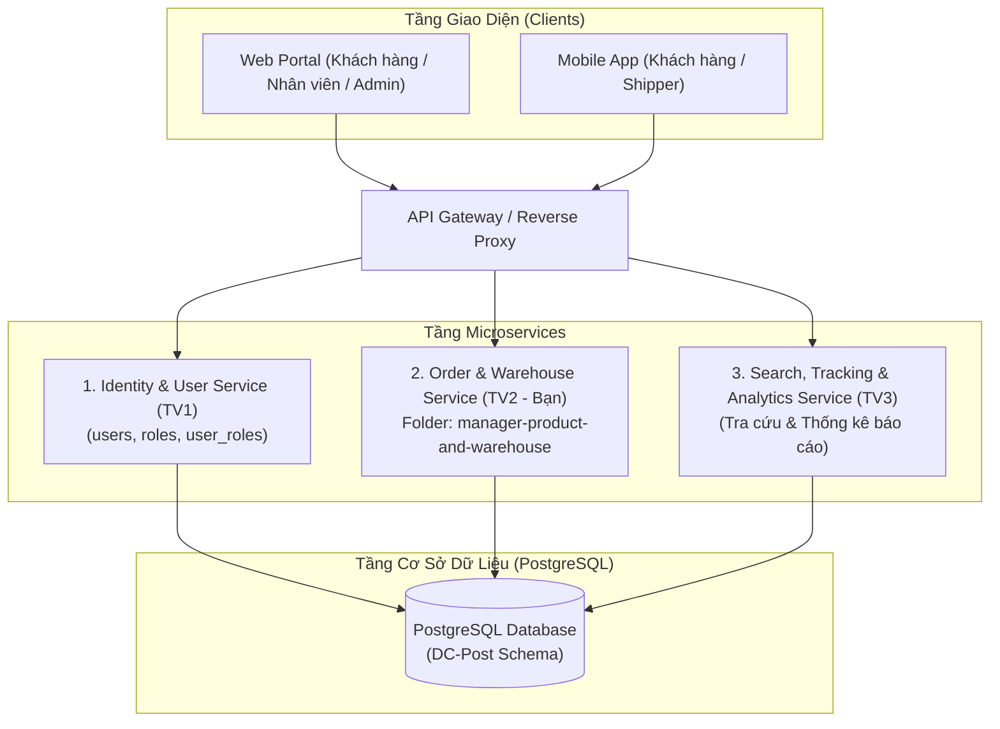
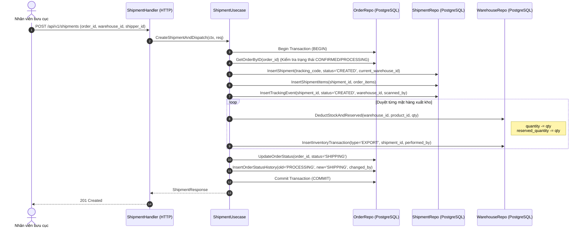
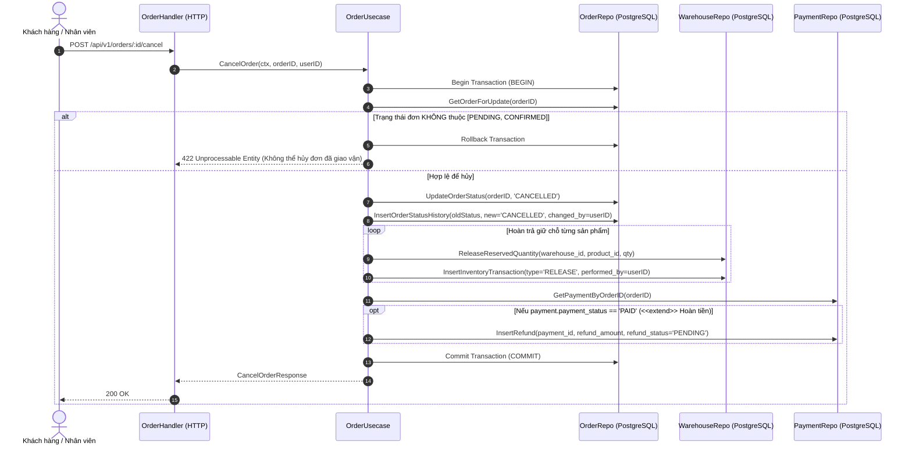
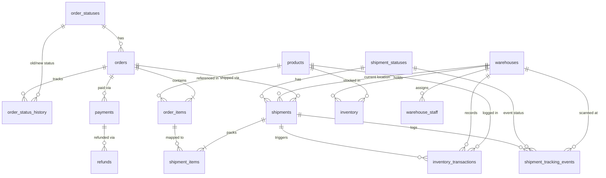

# TÀI LIỆU THIẾT KẾ HỆ THỐNG & CƠ SỞ DỮ LIỆU (SDD - SOFTWARE DESIGN DOCUMENT)
## Microservice: Quản Lý Đơn Hàng & Quản Lý Kho (`manager-product-and-warehouse`)

---

## 1. Thiết Kế Kiến Trúc Tổng Thể (High-Level Architecture)

### 1.1. Mô hình Microservice cho nhóm 3 thành viên
Hệ thống **DC-Post (Quản lý vận đơn)** được phân rã theo **Domain-Driven Design (DDD)** thành 3 Bounded Context tương ứng với 3 thành viên:



### 1.2. Cơ chế phối hợp giữa các Microservice (Shared PostgreSQL DB)
1. **Dùng chung 1 PostgreSQL Database (Team 3 người) — Không dùng Foreign Key Constraint vật lý giữa các bảng:**
   - Cả 3 Microservice kết nối vào **cùng 1 PostgreSQL Database (`dc_post`)**.
   - Thành viên 1 (`Identity & User Service`) sở hữu 3 bảng: `users`, `roles`, `user_roles`.
   - Service `manager-product-and-warehouse` (Thành viên 2) sở hữu 15 bảng của nghiệp vụ Đơn hàng & Kho.
   - **Quy tắc ràng buộc DB (No Cross-Table Constraints):** Theo thống nhất thiết kế của dự án, **không khai báo `FOREIGN KEY` constraint vật lý giữa các bảng trong PostgreSQL** (chỉ giữ `PRIMARY KEY`, `UNIQUE` trên các mã code nghiệp vụ và `NOT NULL`). Toàn bộ tính toàn vẹn liên kết (`order_id`, `product_id`, `warehouse_id`, `user_id`...) được kiểm tra và đảm bảo ở tầng **Application / Usecase (Golang)** kết hợp với Transaction, giúp 3 thành viên chạy migration độc lập không phụ thuộc thứ tự tạo bảng.
2. **Xác thực & Phân quyền (Auth & RBAC):**
   - `Identity & User Service` phát hành **JWT (HS256, dùng chung `JWT_SECRET`)** với payload chuẩn: `{ "user_id": 105, "email": "...", "role": "CUSTOMER" | "STAFF" | "ADMIN" }`.
   - Service `manager-product-and-warehouse` dùng **JWT Auth Middleware** để kiểm tra token, trích xuất `user_id` và `role`.
   - **Phân quyền theo kho (`warehouse_staff`):** Tài khoản `ADMIN` có quyền thao tác trên mọi kho; tài khoản `STAFF` chỉ được phép nhập/xuất/kiểm kê kho và xuất vận đơn tại `warehouse_id` mà nhân viên đó được phân công trong bảng `warehouse_staff`.
3. **Quản lý Giao dịch (Transaction Boundary):**
   - Toàn bộ bảng của **UC01 (Quản lý đơn hàng)** và **UC02 (Quản lý kho)** nằm chung trong 1 service `manager-product-and-warehouse`.
   - Các thao tác liên hoàn như **"Tạo đơn hàng -> Giữ chỗ tồn kho -> Tạo thanh toán"** hoặc **"Tạo vận đơn -> Xuất kho -> Ghi lịch sử ra/vào kho"** được thực hiện trong **1 ACID Database Transaction nội bộ** của PostgreSQL.

---

## 2. Thiết Kế Luồng Tương Tác Chi Tiết (Sequence Diagrams)

### 2.1. Luồng Tạo Đơn Hàng, Giữ Chỗ Kho & Thanh Toán (`UC01.1` & `UC01.2`)

```mermaid
sequenceDiagram
    autonumber
    actor Actor as Khách hàng / Nhân viên
    participant Handler as OrderHandler (HTTP)
    participant Usecase as OrderUsecase
    participant InvRepo as WarehouseRepo (PostgreSQL)
    participant OrdRepo as OrderRepo (PostgreSQL)
    participant PayRepo as PaymentRepo (PostgreSQL)

    Actor->>Handler: POST /api/v1/orders (custom_id, warehouse_id, items, payment_method)
    Handler->>Handler: Validate JWT & Request DTO
    Handler->>Usecase: CreateOrder(ctx, req)
    
    Usecase->>OrdRepo: Begin Transaction (BEGIN)
    loop Duyệt từng sản phẩm trong đơn
        Usecase->>InvRepo: GetProduct & LockInventoryForUpdate(warehouse_id, product_id)
        alt Tồn khả dụng (quantity - reserved_quantity) < đặt mua
            InvRepo-->>Usecase: ErrInsufficientStock
            Usecase->>OrdRepo: Rollback Transaction
            Usecase-->>Handler: 400 Bad Request (Thiếu hàng tồn kho)
        else Đủ tồn kho
            Usecase->>InvRepo: IncreaseReservedQuantity(warehouse_id, product_id, qty)
            Usecase->>InvRepo: InsertInventoryTransaction(type='RESERVE')
        end
    end

    Usecase->>OrdRepo: InsertOrder(order_code, status='PENDING', total_amount)
    Usecase->>OrdRepo: InsertOrderItems(order_id, items)
    Usecase->>OrdRepo: InsertOrderStatusHistory(old=NULL, new='PENDING', changed_by)
    Usecase->>PayRepo: InsertPayment(order_id, amount, payment_method, status='PENDING')
    
    Usecase->>OrdRepo: Commit Transaction (COMMIT)
    Usecase-->>Handler: OrderDetailResponse
    Handler-->>Actor: 201 Created (JSON)
```

---

### 2.2. Luồng Tạo Vận Đơn, Xuất Kho & Cập Nhật Hành Trình Giao Hàng (`UC01.3`, `UC01.6` & `UC02.3`)



---

### 2.3. Luồng Hủy Đơn Hàng, Nhả Tồn Kho & Hoàn Tiền (`UC01.4` & `UC01.5`)



---

## 3. Thiết Kế Máy Trạng Thái (State Machine Design)

### 3.1. Bảng quy tắc chuyển trạng thái Đơn hàng (`order_statuses`) & API kích hoạt

| Trạng thái hiện tại (`old_status`) | Trạng thái đích hợp lệ (`new_status`) | API kích hoạt (Single Source of Truth) | Tác nhân được phép | Hành động hệ thống đi kèm (Side Effects) |
| :--- | :--- | :--- | :--- | :--- |
| *(Khởi tạo)* | `PENDING` | `POST /api/v1/orders` | `CUSTOMER`, `STAFF`, `ADMIN` | Lưu `orders.warehouse_id`, giữ chỗ tồn kho (`reserved_quantity += qty`), tạo bản ghi `payments`. |
| `PENDING` | `CONFIRMED` | `PATCH /api/v1/orders/:id/status` | `STAFF`, `ADMIN` | Ghi `order_status_history`. |
| `PENDING` | `CANCELLED` | `POST /api/v1/orders/:id/cancel` | `CUSTOMER`, `STAFF`, `ADMIN` | Nhả tồn kho giữ chỗ tại `orders.warehouse_id` (`reserved_quantity -= qty`). Nếu đã thanh toán -> Tạo `refunds`. |
| `CONFIRMED` | `PROCESSING` | `PATCH /api/v1/orders/:id/status` | `STAFF`, `ADMIN` | Kho bắt đầu nhặt hàng & đóng gói. |
| `CONFIRMED` | `CANCELLED` | `POST /api/v1/orders/:id/cancel` | `CUSTOMER`, `STAFF`, `ADMIN` | Nhả tồn kho giữ chỗ tại `orders.warehouse_id`. Nếu đã thanh toán -> Tạo `refunds`. |
| `PROCESSING` | `SHIPPING` | `POST /api/v1/shipments` *(Cấm đổi trực tiếp qua PATCH status)* | `STAFF`, `ADMIN` | Tạo 1 vận đơn trọn gói (1 Order = 1 Shipment) từ `order_items`, trừ tồn kho thật tại `orders.warehouse_id` (`quantity -= qty`, `reserved_quantity -= qty`), ghi `inventory_transactions` (`EXPORT`). |
| `SHIPPING` | `DELIVERED` | `POST /api/v1/shipments/:id/tracking-events` (`status=DELIVERED`) | `STAFF`, `ADMIN` | Đồng bộ `orders.status = DELIVERED`, cập nhật `shipments.delivered_at = NOW()`. Nếu đơn `COD` -> Tự động cập nhật `payments.payment_status = 'PAID'`, `paid_at = NOW()`. |
| `SHIPPING` | `RETURNED` | `POST /api/v1/shipments/:id/tracking-events` (`status=RETURNED`) | `STAFF`, `ADMIN` | Đồng bộ `orders.status = RETURNED`, nhập hoàn kho tại `warehouse_id` nơi quét hoàn (`quantity += qty`), ghi `inventory_transactions` (`RETURN`, gắn `shipment_id`). |

---

## 4. Thiết Kế Cơ Sở Dữ Liệu Chi Tiết (Từ Điển Dữ Liệu - Data Dictionary)

Dưới đây là đặc tả 15 bảng dữ liệu trong PostgreSQL bám sát **Sơ đồ ERD** của dự án.

### 4.1. Sơ đồ Quan hệ Thực thể (Mermaid ER Diagram)



---

### 4.2. Đặc tả chi tiết từng bảng (Table Specifications)

> [!NOTE]
> **Quy ước Database:** Không tạo ràng buộc `FOREIGN KEY` giữa các bảng trong PostgreSQL. Các cột ghi chú *(Logical Ref -> ...)* thể hiện quan hệ logic theo sơ đồ ERD và được kiểm tra tồn tại ở tầng Usecase (Go).

#### Bảng 1: `products` (Danh mục Sản phẩm / Hàng hóa)
| Tên cột | Kiểu dữ liệu (PostgreSQL) | Ràng buộc DB | Mô tả |
| :--- | :--- | :--- | :--- |
| `product_id` | `SERIAL` | `PRIMARY KEY` | Mã định danh sản phẩm tự tăng |
| `product_code` | `VARCHAR(255)` | `UNIQUE NOT NULL` | Mã SKU sản phẩm (VD: `PRD-001`) |
| `product_name` | `VARCHAR(255)` | `NOT NULL` | Tên sản phẩm / hàng hóa |
| `unit_price` | `DECIMAL(15, 2)` | `NOT NULL` | Đơn giá niêm yết (`>= 0` kiểm tra ở tầng Go) |

#### Bảng 2: `warehouses` (Danh mục Kho / Bưu cục)
| Tên cột | Kiểu dữ liệu (PostgreSQL) | Ràng buộc DB | Mô tả |
| :--- | :--- | :--- | :--- |
| `warehouse_id` | `SERIAL` | `PRIMARY KEY` | Mã định danh kho tự tăng |
| `warehouse_name` | `VARCHAR(255)` | `NOT NULL` | Tên kho / bưu cục |
| `address` | `VARCHAR(255)` | `NOT NULL` | Địa chỉ kho |

#### Bảng 3: `warehouse_staff` (Phân công Nhân viên Kho)
| Tên cột | Kiểu dữ liệu (PostgreSQL) | Ràng buộc DB | Mô tả |
| :--- | :--- | :--- | :--- |
| `warehouse_id` | `INTEGER` | `PRIMARY KEY (warehouse_id, user_id)` | Mã kho *(Logical Ref -> `warehouses.warehouse_id`)* |
| `user_id` | `INTEGER` | `PRIMARY KEY (warehouse_id, user_id)` | Mã nhân viên phụ trách kho *(Logical Ref -> `users.user_id`)* |

#### Bảng 4: `inventory` (Quản lý Hàng tồn kho theo từng Kho)
| Tên cột | Kiểu dữ liệu (PostgreSQL) | Ràng buộc DB | Mô tả |
| :--- | :--- | :--- | :--- |
| `inventory_id` | `SERIAL` | `PRIMARY KEY` | Mã định danh dòng tồn kho |
| `warehouse_id` | `INTEGER` | `NOT NULL` | Kho lưu trữ *(Logical Ref -> `warehouses.warehouse_id`)* |
| `product_id` | `INTEGER` | `NOT NULL` | Sản phẩm lưu trữ *(Logical Ref -> `products.product_id`)* |
| `quantity` | `INTEGER` | `NOT NULL DEFAULT 0` | Tổng tồn kho vật lý thực tế |
| `reserved_quantity` | `INTEGER` | `NOT NULL DEFAULT 0` | Số lượng đang giữ chỗ cho đơn chưa xuất |
| *(Unique Index)* | | `UNIQUE (warehouse_id, product_id)` | Mỗi sản phẩm tại 1 kho chỉ có 1 bản ghi tồn |

#### Bảng 5: `inventory_transactions` (Lịch sử hàng hóa ra/vào kho)
| Tên cột | Kiểu dữ liệu (PostgreSQL) | Ràng buộc DB | Mô tả |
| :--- | :--- | :--- | :--- |
| `transaction_id` | `SERIAL` | `PRIMARY KEY` | Mã giao dịch kho |
| `product_id` | `INTEGER` | `NOT NULL` | Sản phẩm biến động *(Logical Ref -> `products.product_id`)* |
| `warehouse_id` | `INTEGER` | `NOT NULL` | Kho phát sinh biến động *(Logical Ref -> `warehouses.warehouse_id`)* |
| `shipment_id` | `INTEGER` | `NULL` | Vận đơn liên quan *(Logical Ref -> `shipments.shipment_id`)* |
| `performed_by` | `INTEGER` | `NOT NULL` | ID người thực hiện *(Logical Ref -> `users.user_id`)* |
| `transaction_type` | `VARCHAR(255)` | `NOT NULL` | Loại: `IMPORT`, `EXPORT`, `RESERVE`, `RELEASE`, `RETURN`, `ADJUST` |
| `quantity` | `INTEGER` | `NOT NULL` | Số lượng biến động |
| `created_at` | `TIMESTAMPTZ` | `NOT NULL DEFAULT NOW()` | Thời điểm phát sinh giao dịch |

#### Bảng 6: `order_statuses` (Danh mục Trạng thái Đơn hàng)
| Tên cột | Kiểu dữ liệu (PostgreSQL) | Ràng buộc DB | Mô tả |
| :--- | :--- | :--- | :--- |
| `status_id` | `SERIAL` | `PRIMARY KEY` | Mã định danh trạng thái |
| `status_code` | `VARCHAR(255)` | `UNIQUE NOT NULL` | Mã trạng thái (`PENDING`, `CONFIRMED`, `PROCESSING`, `SHIPPING`, `DELIVERED`, `CANCELLED`, `RETURNED`) |
| `status_name` | `VARCHAR(255)` | `NOT NULL` | Tên hiển thị tiếng Việt |

#### Bảng 7: `orders` (Đơn hàng)
| Tên cột | Kiểu dữ liệu (PostgreSQL) | Ràng buộc DB | Mô tả |
| :--- | :--- | :--- | :--- |
| `order_id` | `SERIAL` | `PRIMARY KEY` | Mã định danh đơn hàng |
| `order_code` | `VARCHAR(255)` | `UNIQUE NOT NULL` | Mã đơn hàng hiển thị (VD: `ORD-20261124-0001`) |
| `custom_id` | `INTEGER` | `NOT NULL` | ID Khách hàng đặt đơn *(Logical Ref -> `users.user_id`)* |
| `warehouse_id` | `INTEGER` | `NOT NULL` | Kho xử lý đơn *(Logical Ref -> `warehouses.warehouse_id`, bổ sung để giữ/nhả kho chính xác)* |
| `status_id` | `INTEGER` | `NOT NULL` | Trạng thái hiện tại *(Logical Ref -> `order_statuses.status_id`)* |
| `total_amount` | `DECIMAL(15, 2)` | `NOT NULL DEFAULT 0` | Tổng giá trị đơn hàng |
| `payment_method` | `VARCHAR(255)` | `NOT NULL` | Phương thức thanh toán (`COD`, `BANK_TRANSFER`, `E_WALLET`) |
| `created_at` | `TIMESTAMPTZ` | `NOT NULL DEFAULT NOW()` | Thời gian tạo đơn |

#### Bảng 8: `order_items` (Chi tiết Mặt hàng trong Đơn)
| Tên cột | Kiểu dữ liệu (PostgreSQL) | Ràng buộc DB | Mô tả |
| :--- | :--- | :--- | :--- |
| `order_item_id` | `SERIAL` | `PRIMARY KEY` | Mã dòng chi tiết đơn hàng |
| `order_id` | `INTEGER` | `NOT NULL` | Đơn hàng sở hữu *(Logical Ref -> `orders.order_id`)* |
| `product_id` | `INTEGER` | `NOT NULL` | Sản phẩm được đặt *(Logical Ref -> `products.product_id`)* |
| `item_name` | `VARCHAR(255)` | `NOT NULL` | Snapshot tên sản phẩm tại thời điểm đặt |
| `quantity` | `INTEGER` | `NOT NULL` | Số lượng đặt (`> 0` kiểm tra ở tầng Go) |
| `unit_price` | `DECIMAL(15, 2)` | `NOT NULL` | Snapshot đơn giá tại thời điểm đặt |

#### Bảng 9: `order_status_history` (Lịch sử Trạng thái Đơn hàng)
| Tên cột | Kiểu dữ liệu (PostgreSQL) | Ràng buộc DB | Mô tả |
| :--- | :--- | :--- | :--- |
| `history_id` | `SERIAL` | `PRIMARY KEY` | Mã lịch sử trạng thái |
| `order_id` | `INTEGER` | `NOT NULL` | Mã đơn hàng *(Logical Ref -> `orders.order_id`)* |
| `old_status_id` | `INTEGER` | `NULL` | Trạng thái cũ (`NULL` khi mới tạo đơn) |
| `new_status_id` | `INTEGER` | `NOT NULL` | Trạng thái mới *(Logical Ref -> `order_statuses.status_id`)* |
| `changed_by` | `INTEGER` | `NOT NULL` | Người thực hiện đổi trạng thái *(Logical Ref -> `users.user_id`)* |
| `change_at` | `TIMESTAMPTZ` | `NOT NULL DEFAULT NOW()` | Thời điểm thay đổi trạng thái |

#### Bảng 10: `payments` (Thanh toán Đơn hàng)
| Tên cột | Kiểu dữ liệu (PostgreSQL) | Ràng buộc DB | Mô tả |
| :--- | :--- | :--- | :--- |
| `payment_id` | `SERIAL` | `PRIMARY KEY` | Mã giao dịch thanh toán |
| `order_id` | `INTEGER` | `NOT NULL` | Đơn hàng thanh toán *(Logical Ref -> `orders.order_id`)* |
| `amount` | `DECIMAL(15, 2)` | `NOT NULL` | Số tiền thanh toán |
| `payment_method` | `VARCHAR(255)` | `NOT NULL` | Phương thức (`COD`, `BANK_TRANSFER`, `E_WALLET`) |
| `payment_status` | `VARCHAR(255)` | `NOT NULL` | Trạng thái: `PENDING`, `PAID`, `FAILED`, `REFUNDED` |
| `transaction_code` | `VARCHAR(255)` | `NULL` | Mã giao dịch ngân hàng/ví điện tử |
| `paid_at` | `TIMESTAMPTZ` | `NULL` | Thời điểm hoàn tất thanh toán |

#### Bảng 11: `refunds` (Hoàn tiền khi Hủy đơn)
| Tên cột | Kiểu dữ liệu (PostgreSQL) | Ràng buộc DB | Mô tả |
| :--- | :--- | :--- | :--- |
| `refund_id` | `SERIAL` | `PRIMARY KEY` | Mã yêu cầu hoàn tiền |
| `payment_id` | `INTEGER` | `NOT NULL` | Giao dịch thanh toán gốc *(Logical Ref -> `payments.payment_id`)* |
| `refund_amount` | `DECIMAL(15, 2)` | `NOT NULL` | Số tiền hoàn trả |
| `refund_status` | `VARCHAR(255)` | `NOT NULL` | Trạng thái: `PENDING`, `COMPLETED`, `REJECTED` |
| `created_at` | `TIMESTAMPTZ` | `NOT NULL DEFAULT NOW()` | Thời điểm tạo yêu cầu hoàn tiền |

#### Bảng 12: `shipment_statuses` (Danh mục Trạng thái Vận đơn)
| Tên cột | Kiểu dữ liệu (PostgreSQL) | Ràng buộc DB | Mô tả |
| :--- | :--- | :--- | :--- |
| `status_id` | `SERIAL` | `PRIMARY KEY` | Mã định danh trạng thái vận đơn |
| `status_code` | `VARCHAR(255)` | `UNIQUE NOT NULL` | Mã (`CREATED`, `IN_TRANSIT`, `OUT_FOR_DELIVERY`, `DELIVERED`, `RETURNED`) |
| `status_name` | `VARCHAR(255)` | `NOT NULL` | Tên trạng thái vận đơn |

#### Bảng 13: `shipments` (Vận đơn Giao hàng)
| Tên cột | Kiểu dữ liệu (PostgreSQL) | Ràng buộc DB | Mô tả |
| :--- | :--- | :--- | :--- |
| `shipment_id` | `SERIAL` | `PRIMARY KEY` | Mã vận đơn |
| `order_id` | `INTEGER` | `NOT NULL` | Đơn hàng gốc *(Logical Ref -> `orders.order_id`)* |
| `tracking_code` | `VARCHAR(255)` | `UNIQUE NOT NULL` | Mã vận đơn tra cứu (VD: `TRK-20261124-9981`) |
| `shipper_id` | `INTEGER` | `NULL` | Nhân viên giao hàng *(Logical Ref -> `users.user_id`)* |
| `status_id` | `INTEGER` | `NOT NULL` | Trạng thái vận đơn *(Logical Ref -> `shipment_statuses.status_id`)* |
| `current_warehouse_id`| `INTEGER` | `NULL` | Kho hiện tại đang giữ kiện hàng *(Logical Ref -> `warehouses.warehouse_id`)* |
| `cod_amount` | `DECIMAL(15, 2)` | `NOT NULL DEFAULT 0` | Số tiền thu hộ COD |
| `delivered_at` | `TIMESTAMPTZ` | `NULL` | Thời điểm giao hàng thành công *(Chuẩn hóa từ `deliverd_at`)* |

#### Bảng 14: `shipment_items` (Chi tiết Kiện hàng trong Vận đơn)
| Tên cột | Kiểu dữ liệu (PostgreSQL) | Ràng buộc DB | Mô tả |
| :--- | :--- | :--- | :--- |
| `shipment_item_id` | `SERIAL` | `PRIMARY KEY` | Mã chi tiết kiện hàng |
| `shipment_id` | `INTEGER` | `NOT NULL` | Mã vận đơn *(Logical Ref -> `shipments.shipment_id`)* |
| `order_item_id` | `INTEGER` | `NOT NULL` | Dòng sản phẩm trong đơn *(Logical Ref -> `order_items.order_item_id`)* |
| `quantity` | `INTEGER` | `NOT NULL` | Số lượng đóng gói trong vận đơn |

#### Bảng 15: `shipment_tracking_events` (Lịch sử Hành trình Giao hàng / Quét kho)
| Tên cột | Kiểu dữ liệu (PostgreSQL) | Ràng buộc DB | Mô tả |
| :--- | :--- | :--- | :--- |
| `event_id` | `SERIAL` | `PRIMARY KEY` | Mã sự kiện hành trình |
| `shipment_id` | `INTEGER` | `NOT NULL` | Mã vận đơn *(Logical Ref -> `shipments.shipment_id`)* |
| `status_id` | `INTEGER` | `NOT NULL` | Trạng thái tại thời điểm quét *(Logical Ref -> `shipment_statuses.status_id`)* |
| `warehouse_id` | `INTEGER` | `NULL` | Kho hiện tại vừa quét mã nhận *(Logical Ref -> `warehouses.warehouse_id`)* |
| `scanned_by` | `INTEGER` | `NOT NULL` | Nhân viên quét mã *(Logical Ref -> `users.user_id`)* |
| `from_warehouse_id` | `INTEGER` | `NULL` | Kho xuất phát trước đó *(Logical Ref -> `warehouses.warehouse_id`)* |
| `scanned_at` | `TIMESTAMPTZ` | `NOT NULL DEFAULT NOW()` | Thời gian quét mã |

---

## 5. Thiết Kế Chỉ Mục (Database Indexing) & Tối Ưu Hiệu Năng

Để đảm bảo tốc độ truy vấn cao khi dữ liệu đơn hàng và lịch sử kho tăng lớn, hệ thống thiết kế các B-Tree Index sau:
1. **Tra cứu Đơn hàng:**
   - `idx_orders_custom_id_created_at` trên `orders(custom_id, created_at DESC)` — Tăng tốc độ Khách hàng xem danh sách đơn của mình.
   - `idx_orders_status_id` trên `orders(status_id)` — Tăng tốc độ Nhân viên lọc đơn theo trạng thái.
2. **Tra cứu Tồn kho & Lịch sử Kho:**
   - `uq_inventory_warehouse_product` trên `inventory(warehouse_id, product_id)` — Phục vụ khóa dòng nhanh khi đặt hàng (`SELECT ... FOR UPDATE`).
   - `idx_inv_tx_warehouse_created` trên `inventory_transactions(warehouse_id, created_at DESC)` — Tăng tốc truy vấn lịch sử hàng hóa ra/vào kho.
   - `idx_inv_tx_product_id` trên `inventory_transactions(product_id)`.
3. **Tra cứu Lịch sử Giao hàng:**
   - `idx_shipment_events_shipment_scanned` trên `shipment_tracking_events(shipment_id, scanned_at DESC)`.
